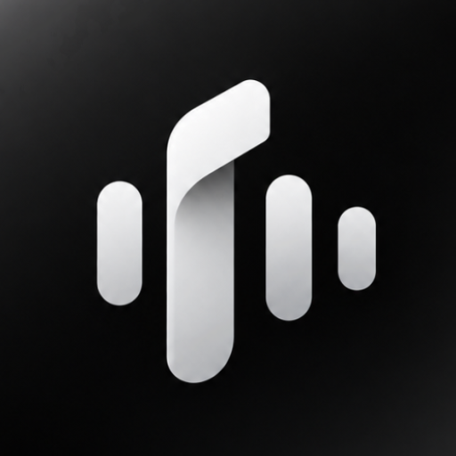

<div align="center">

  

  # FreQ Desktop
  
  **A futuristic, liquid-glass music streaming experience for Windows.**

  [](https://github.com/soumalyajoardar/FreQ/releases/latest)
  [](https://github.com/soumalyajoardar/FreQ/releases)
  [](https://github.com/soumalyajoardar/FreQ/releases)
  [](https://www.electronjs.org/)
  [](LICENSE)

  <p>
    <strong>Zero Ads. Zero Tracking. Zero Accounts. Zero Bloat.</strong><br/>
    Your library, your music, your device — strictly local-first.
  </p>

</div>

---

## 🔮 Overview

**FreQ Desktop** is an ultra-modern, aesthetic Windows music application built for audiophiles and design enthusiasts. Crafted with an immersive **liquid-glass obsidian aesthetic**, real-time **Web Audio DSP spatializers**, and **synchronized 3D flip-card lyrics**, FreQ brings a desktop audio experience unlike anything else.

---

## ✨ Key Features

### 🎚️ Audio Routing & Hardware Device Selector
- **Dynamic Output Switching**: Seamlessly route audio between Speakers, Headphones, Earphones, Bluetooth devices, and Virtual Audio cables right from the top bar.
- **Smart Hardware Detection**: Auto-detects audio device classes with real-time OS hotplugging (`devicechange`) support.

### 🎧 Signature Audio Flavors (Real-Time DSP)
Transform any track instantly with zero latency using our Web Audio DSP pipeline:
- **Normal**: Pure, dry playback at 1.0x — the untouched signal.
- **SNR (Slowed + Reverb)**: 0.8x tempo reduction paired with authentic procedural stereo `ConvolverNode` impulse response reverb.
- **Nightcore**: 1.2x upbeat tempo + high-frequency pitch boost for high-energy sessions.

### 🌟 HD 3D & QHD 4D Spatializer Presets
- **HD 3D**: Bit-perfect neutral signal for purist listening.
- **QHD 4D**: High-definition clarity enhancement and wide stereo spatializer with active visual pulse indicators.

### 🎤 3D Tap-to-Flip Synced Lyrics
- Click on any album art to flip the track card in true 3D space into real-time **Synced Lyrics** powered by LRCLIB.
- Automatic smooth line-by-line scrolling and interactive click-to-seek timestamp navigation.

### 📻 Listen Together (Synchronized Room Parties)
- Host or join low-latency synchronized listening parties with up to 5 friends over MQTT websockets.
- Synchronized playback, shared scrub seeking, and live listener presence.

### 🎮 Discord Rich Presence
- Show off your listening sessions on Discord with high-resolution album artwork, track progress, artist info, and interactive join buttons for friends.

### 🎨 Liquid-Glass Design System
- Frameless Windows acrylic chrome with custom liquid-glass controls.
- Dynamic **Time-of-Day Backgrounds** (Morning, Afternoon, Evening, Night) transitioning automatically with your clock.
- Custom playlist cover art uploads with on-the-fly local compression.

### 🛡️ Privacy & Performance First
- **Strictly Local-First**: Playlists, favorites, search history, and cache stay on your hard drive in `freq_library.json`.
- **Offline Downloads**: High-speed audio extraction via a native `yt-dlp` bridge with automatic JioSaavn fallback.
- **Zero Ads & Zero Telemetry**: Clean audio streams without interruptions.

---

## ⌨️ Desktop Shortcuts

| Shortcut | Action |
|---|---|
| <kbd>Space</kbd> | Play / Pause |
| <kbd>Ctrl</kbd> + <kbd>→</kbd> | Next Track |
| <kbd>Ctrl</kbd> + <kbd>←</kbd> | Previous Track |
| <kbd>→</kbd> / <kbd>←</kbd> | Seek forward / backward (5s) |
| <kbd>↑</kbd> / <kbd>↓</kbd> | Volume up / down (5%) |
| <kbd>M</kbd> | Mute / Unmute |
| <kbd>L</kbd> | Like / Unlike current track |
| <kbd>S</kbd> | Toggle Shuffle |
| <kbd>R</kbd> | Cycle Repeat Mode (Off / All / One) |
| <kbd>F</kbd> | Open / Close Fullscreen Now Playing |
| <kbd>Esc</kbd> | Close Modal / Drawer / Menus |

---

## 📥 Installation

Download the latest version from the [**Releases Page**](https://github.com/soumalyajoardar/FreQ/releases/latest):

- **NSIS Installer**: `FreQ.Setup.2.5.0.exe` (Automatic desktop shortcut & updater support)
- **Portable Edition**: `FreQ-Portable-2.5.0.exe` (Standalone, runs anywhere without installation)

---

## 🛠️ Development & Building

### Prerequisites
- Node.js 20+
- npm or pnpm
- Python 3.10+ (for `yt-dlp` audio resolver development)

### Clone & Install
```bash
git clone https://github.com/soumalyajoardar/FreQ.git
cd FreQ
npm install
```

### Run Locally
```bash
# Start Vite dev server + Electron shell:
npm run dev
```

### Build Distribution
```bash
# Compile UI and Electron bundles:
npm run build

# Package Windows binaries:
npx electron-builder --win
```

---

## 👥 Contributors & Acknowledgements

A huge thank you to the talented contributors who have helped shape FreQ:

<table>
  <tr>
    <td align="center" width="150px">
      <a href="https://github.com/soumalyajoardar">
        <br />
        <sub><b>Soumalya Joardar</b></sub>
      </a><br />
      <small>Creator & Lead Developer</small>
    </td>
    <td align="center" width="150px">
      <a href="https://github.com/Shrish-lol">
        <br />
        <sub><b>Shrish Badmosh</b></sub>
      </a><br />
      <small>Contributor</small>
    </td>
  </tr>
</table>

- **[Shrish-lol](https://github.com/Shrish-lol)** — Contributed significant development work and improvements to the project.
- **[yt-dlp](https://github.com/yt-dlp/yt-dlp)** — Audio resolution pipeline.
- **[LRCLIB](https://lrclib.net/)** — Real-time synced lyrics provider.

---

## 📄 License

FreQ is open-source software licensed under the **GNU General Public License v3.0 (GPL-3.0)**. See the [LICENSE](LICENSE) file for more information.

<div align="center">
  <sub>Crafted with 💜 for pure, uninterrupted sound.</sub>
</div>
